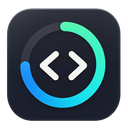
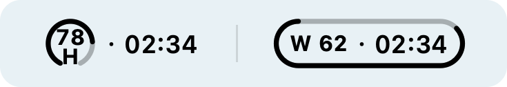
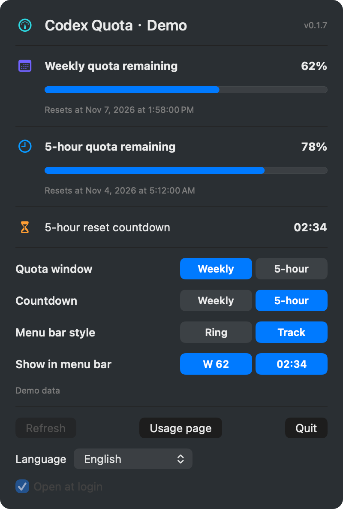

# Codex Quota Bar



See how much Codex quota you have left and when it resets, right in the Mac menu bar or Ubuntu top panel.

**[Download for Apple Silicon](https://github.com/ZhaoOyu/codex-quota-bar/releases/download/v0.1.12/codex-quota-bar-macos-arm64.zip)** · [Intel Mac](https://github.com/ZhaoOyu/codex-quota-bar/releases/download/v0.1.12/codex-quota-bar-macos-x86_64.zip) · [Ubuntu](https://github.com/ZhaoOyu/codex-quota-bar/releases/download/v0.1.12/codex-quota-bar_0.1.12_all.deb) · [简体中文](README.md)



**H** means five hours and **W** means weekly. Choose the quota window and the countdown separately. For example, you can watch your weekly balance while counting down to your next five-hour reset.



- Choose **Ring** to keep your balance visible, with an optional countdown. Choose **Track** to show the number, the countdown or both. Click the previews to select what appears.
- Open the panel for reset dates, automatic updates every minute and a shortcut to your usage page.

## Get started

Sign in to Codex CLI with your ChatGPT account. If this is your first sign-in, run `codex login` in Terminal.

On **macOS 13 or later**, unzip the download, drag Codex Quota Bar into Applications and open it. On **Ubuntu 22.04 or later**, install the downloaded package with `sudo apt install ./codex-quota-bar_0.1.12_all.deb`. GNOME users need Ubuntu AppIndicators enabled.

On Ubuntu, clicking the indicator opens readings and controls directly: refresh, quota/countdown window selection, appearance, visible content, startup and language. The detailed panel remains optional. Track mode encloses the text in one wide image, sized using native text layout for CJK and high-DPI displays. Wide images do not receive symbolic tinting, so the track uses light foreground for Ubuntu's default dark panel. For a custom light panel, choose the theme-aware ring. The macOS track and panel are unchanged.

[Release notes](https://github.com/ZhaoOyu/codex-quota-bar/releases/tag/v0.1.12) · [Report an issue](https://github.com/ZhaoOyu/codex-quota-bar/issues)

The interface follows your system language by default. Open **Language** at the bottom of the panel to switch to **简体中文** or **English**.

## Optional native GNOME panel

On GNOME 45–50, the extension bundled in the DEB provides a native quota panel on a single left click. Click again or press Escape to close. Quota/countdown selection, ring/track mode, visible content, language and login startup are directly controllable. The track encloses native text and follows the panel theme. Accounts without a five-hour window only show weekly quota.

Quit the old app, install the new DEB, reopen the app, then run:

```bash
gnome-extensions enable codex-quota-bar@zhaooyu.github.io
```

If GNOME cannot find a newly installed extension, save your work and log out/in first (especially on Wayland). The old tray hides automatically while the extension is connected. Do not disable the system AppIndicators extension. To return to the original menu:

```bash
gnome-extensions disable codex-quota-bar@zhaooyu.github.io
```

The DEB already includes the extension. Source users can instead install the release's `.shell-extension.zip` with `gnome-extensions install PATH`, log out/in and enable it. Keep Codex Quota Bar v0.1.11+ running; the offline panel provides a Start action. The extension exchanges display data and settings over the user's session D-Bus and never reads login credentials. The original tray returns on disconnect (lease timeout approximately 15 seconds).

GNOME 42–44 retains the existing AppIndicator menu, and macOS is unchanged. Native Shell integration was tested on GNOME 50; versions 45–49 are declared compatible but have not each been tested on a live installation.

## More menu bar apps

- [Mingdu](https://github.com/ZhaoOyu/mingdu/blob/main/README.en.md) · Adjust the brightness of your built-in and external displays separately, or apply a night, everyday, or bright preset to all of them at once.
- [Fengdu](https://github.com/ZhaoOyu/fengdu/blob/main/README.en.md) · Monitor chip temperature and fan speeds on an Apple Silicon Mac with a fan. Set a target RPM or choose a fan curve that responds to temperature.
