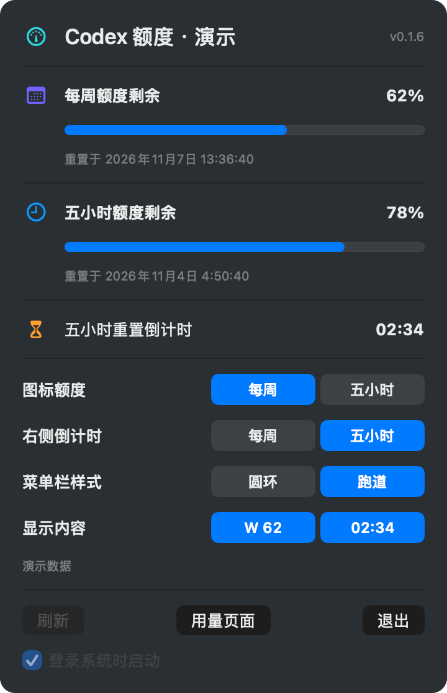

# Codex 余量

五小时额度快用完时，离重置还有多久？把余量和倒计时放在 Mac 菜单栏或 Ubuntu 顶栏，写代码时抬眼就能看到。

**[下载 Mac 版（M 系列芯片）](https://github.com/ZhaoOyu/codex-quota-bar/releases/download/v0.1.6/codex-quota-bar-macos-arm64.zip)** · [Intel Mac](https://github.com/ZhaoOyu/codex-quota-bar/releases/download/v0.1.6/codex-quota-bar-macos-x86_64.zip) · [Ubuntu](https://github.com/ZhaoOyu/codex-quota-bar/releases/download/v0.1.6/codex-quota-bar_0.1.6_all.deb)

## 把最关心的数字放在手边

- **看两种额度。** 图标里的 H 代表五小时，W 代表每周。额度和倒计时可以分开选，比如左边看这周还剩多少，右边看五小时额度何时恢复。
- **自己决定占多少菜单栏空间。** 圆环把剩余比例围在数字外面。跑道可以只放额度、只放倒计时，或两者都放。点击面板里的预览即可切换，高亮的就是当前显示的内容。
- **点开看具体时间。** 面板列出账户可用的额度和重置时间，每分钟刷新。需要查看完整用量时，点击「用量页面」。

## 开始使用

先在本机用 ChatGPT 账号登录 Codex CLI。已经登录过就可以直接打开应用，首次登录可在终端运行 `codex login`。

**Mac（macOS 13 及以上）**　解压下载的 ZIP，把 Codex Quota Bar 拖入「应用程序」并打开。点击菜单栏图标，选择想看的额度。

**Ubuntu（22.04 及以上）**　在下载目录运行 `sudo apt install ./codex-quota-bar_0.1.6_all.deb`，然后从应用列表打开。使用 GNOME 时，请启用 Ubuntu AppIndicators 扩展。

[版本与校验文件](https://github.com/ZhaoOyu/codex-quota-bar/releases/tag/v0.1.6) · [使用问题](https://github.com/ZhaoOyu/codex-quota-bar/issues)
