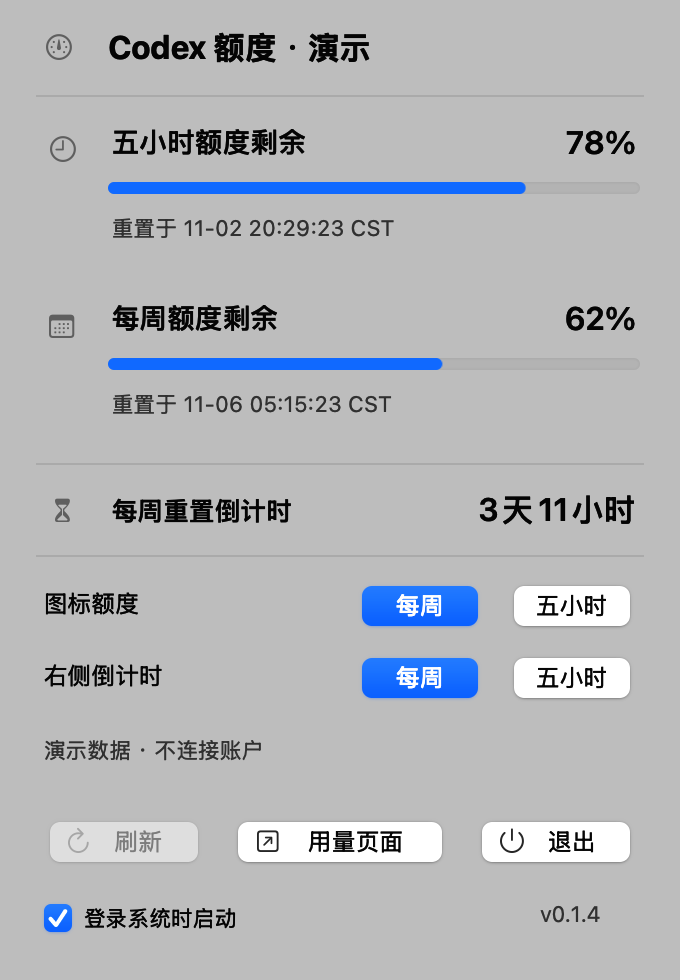
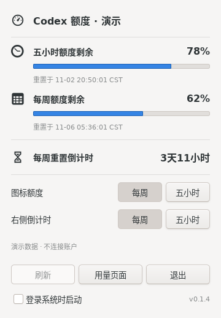
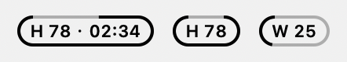

# Codex 余量 · Codex Quota Bar

**下一轮任务，现在开始还是等额度重置？抬眼看一眼菜单栏。**

在 macOS 菜单栏或 Ubuntu 顶部面板，直接看到 **Codex 还剩多少、多久重置**。例如，左边看本周余量，右边看五小时额度何时恢复；不用切走正在写的代码，也不用反复打开用量页。

沿用本机 Codex CLI 的 ChatGPT 登录，无需配置 API Key。打开后，它就安静地待在屏幕上方，自动更新。

**[下载 v0.1.6](https://github.com/ZhaoOyu/codex-quota-bar/releases/tag/v0.1.6)** · [快速上手](#快速上手) · [遇到问题](https://github.com/ZhaoOyu/codex-quota-bar/issues)


## 一眼看余量，按自己的节奏安排工作

- **一个圆环，读懂剩余。** 弧线表示剩余比例，中间是具体数值，底部 `H` / `W` 区分五小时与周额度。数值省略百分号，让菜单栏更紧凑。
- **两种额度，各看所需。** 圆环与倒计时可以独立选择：例如圆环看每周余量，右侧看五小时重置时间。点击“每周 / 五小时”按钮即可切换，选择会自动保存。
- **点开细看，收起继续。** 详情面板集中展示剩余额度、进度条、准确重置时间和更新状态，也能直接打开 Codex 用量页面。
- **融入你熟悉的桌面。** macOS 和 Ubuntu 都使用原生界面，适配系统明暗外观。额度约每分钟自动刷新，倒计时每秒更新；还可以开启“登录系统时启动”。

## 在你的桌面上

| macOS | Ubuntu |
| --- | --- |
|  |  |

*图中数值均为演示数据。实际使用时显示你的账户额度；界面外观随系统主题而变化。*

## 快速上手

### 1. 准备好 Codex 登录

需要在本机安装 [Codex CLI](https://developers.openai.com/codex/cli)，并使用 **ChatGPT 账号**登录。已经登录的用户可以直接下载应用；还没登录时，在终端运行：

```bash
codex login
```

仅使用 API Key 的登录方式不提供本工具所需的 ChatGPT 套餐额度。

### 2. 下载适合你的版本

| 你的电脑 | 下载 |
| --- | --- |
| Mac · Apple Silicon（M 系列芯片） | [下载 Apple Silicon 版](https://github.com/ZhaoOyu/codex-quota-bar/releases/download/v0.1.6/codex-quota-bar-macos-arm64.zip) |
| Mac · Intel 芯片 | [下载 Intel 版](https://github.com/ZhaoOyu/codex-quota-bar/releases/download/v0.1.6/codex-quota-bar-macos-x86_64.zip) |
| Ubuntu 22.04 及以上 | [下载 Ubuntu 安装包](https://github.com/ZhaoOyu/codex-quota-bar/releases/download/v0.1.6/codex-quota-bar_0.1.6_all.deb) |

**macOS：**解压 ZIP，将 **Codex Quota Bar.app** 拖入“应用程序”，然后双击打开。应用出现在菜单栏，不显示 Dock 图标；无需另外安装 Python。

当前 macOS 安装包未使用 Developer ID 签名或公证。如果系统阻止打开，请先核验发布页的 `SHA256SUMS.txt`，再前往“系统设置 → 隐私与安全性”批准打开。

**Ubuntu：**在下载目录打开终端，运行：

```bash
sudo apt install ./codex-quota-bar_0.1.6_all.deb
```

安装后，在应用列表中打开 **Codex Quota Bar**。GNOME 桌面需要启用 **Ubuntu AppIndicators** 扩展，才能显示顶部图标和倒计时。

Mac 版需要 macOS 13 或更新版本。

### 3. 选择你最关心的信息

打开详情面板：macOS 直接点击菜单栏图标；Ubuntu 点击托盘图标后选择 **打开额度面板**，支持的桌面也可中键直接打开。

| 设置 | 显示在哪里 |
| --- | --- |
| **图标额度** → 每周 / 五小时 | 圆环、中央数值和底部 `W` / `H` |
| **右侧倒计时** → 每周 / 五小时 | 圆环右侧的重置时间，以及面板中的重置倒计时 |

首次打开时优先显示可用的五小时额度；账户未提供该额度时显示周额度。你手动选择后，应用会记住你的选择。

## 圆环和跑道怎么选



*图中为演示数据。*

- **圆环**始终显示额度数值和底部的 `H` 或 `W`。点击「显示内容」中的倒计时预览，可以收起或恢复右侧时间。
- **跑道**里可以只放额度、只放倒计时，或同时显示两者。点击预览即可切换，高亮表示已显示，最后一项会保留。边框仍按所选额度的剩余比例点亮。

两种样式分别记住选择。隐藏菜单栏时间后，面板仍可查看重置时间。Mac 原生面板按颜色区分周额度、五小时额度和重置时间。菜单栏中的 H、W 与额度数字同大。

## 常见问题

**圆环里的 `78` 是什么意思？**

表示所选额度还剩 78%。`H` 代表五小时额度，`W` 代表周额度。右侧时间表示距离该处所选额度重置还有多久；超过一天的周倒计时会显示为“几天几小时”。

**为什么看不到五小时额度？**

应用只展示账户实际返回的数据。账户未提供五小时额度时，详情面板会隐藏该区域；如果你手动选择显示五小时额度，对应位置会显示未知值，不会换成其他额度。

**`--`、`待刷新` 或 `!` 代表什么？**

| 显示 | 含义与处理方式 |
| --- | --- |
| `--` / `--:--` | 暂无所选额度或重置时间，可查看另一种额度或稍后刷新 |
| `待刷新` | 已到重置时间，正在等待新的额度数据；也可点击“刷新” |
| `!` | 查询失败或数据未及时更新，请打开详情面板查看提示 |

应用不会在倒计时结束时直接假定额度已恢复。以刷新后返回的数据为准。

**应用提示无法读取额度怎么办？**

先确认终端中的 `codex login status` 显示已登录 ChatGPT 账号；必要时重新运行 `codex login`，再点击面板中的“刷新”。如果仍有问题，可查看[高级排查](docs/DEVELOPMENT.md#找不到-codex-或无法读取额度)或[提交问题](https://github.com/ZhaoOyu/codex-quota-bar/issues)。

**Ubuntu 顶部没有图标？**

在“扩展”应用中启用 **Ubuntu AppIndicators**，必要时重新登录桌面。不同桌面环境对图标、文字和间距的显示可能有所不同。

**它会发送提示词或保存我的登录令牌吗？**

额度查询沿用本机 Codex CLI 的登录状态，不发送提示词、不触发模型推理。本工具不另行保存或输出账号令牌，登录凭据仍由 Codex CLI 管理。

**如何更新或卸载？**

更新时先退出应用，再从 [Releases](https://github.com/ZhaoOyu/codex-quota-bar/releases/latest) 下载对应版本：macOS 替换“应用程序”中的旧应用，Ubuntu 用 `sudo apt install ./下载的文件名.deb` 安装，然后重新打开。

卸载前关闭“登录系统时启动”并退出应用。macOS 删除应用即可；Ubuntu 运行 `sudo apt remove codex-quota-bar`。需要一并清理显示偏好时，参见[配置清理](docs/DEVELOPMENT.md#配置清理)。

---

[更新记录](https://github.com/ZhaoOyu/codex-quota-bar/releases) · [反馈问题](https://github.com/ZhaoOyu/codex-quota-bar/issues) · [源码运行与开发](docs/DEVELOPMENT.md) · [MIT 开源许可](LICENSE)

这是独立开源工具，与 OpenAI 无隶属关系。

**English:** Your Codex quota, a glance away. A native menu bar companion for macOS and Ubuntu: see remaining usage and reset time without leaving your work, and choose weekly or five-hour information independently. Uses your existing Codex CLI ChatGPT login. No prompts, no inference.
